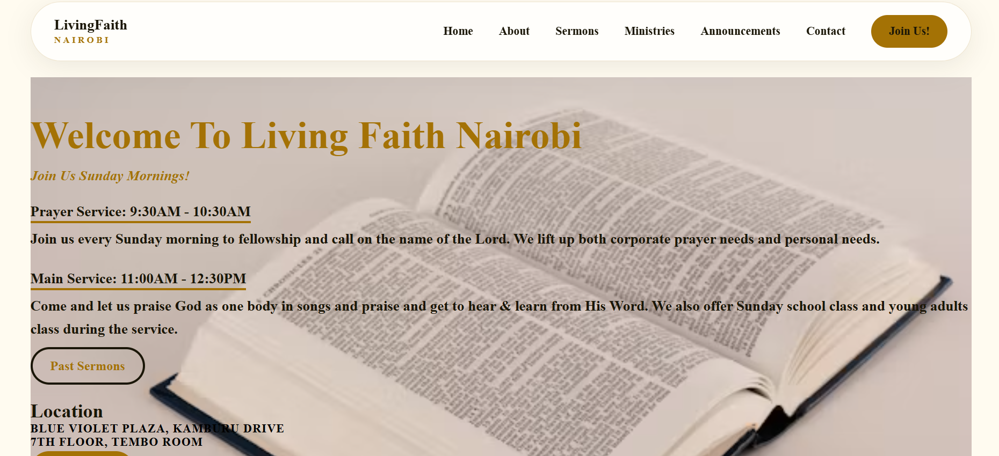
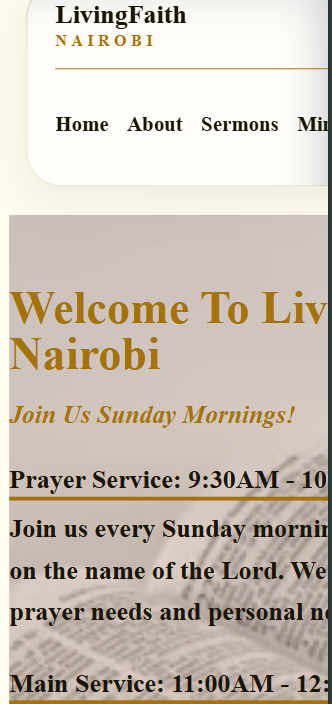

# Living Faith Nairobi - Church Website

An active and interactive church website capstone project for Living Faith Nairobi, a church based in Kilimani, Nairobi.

**Live Link:** https://david-mwonge123.github.io/living_faith_nairobi/

## Overview
Living Faith Nairobi website is designed to be warm, welcoming and functional. The goal is to create a modern church online home where a first-time visitor feels safe, members find information quickly, and giving details are easily accessible.

The design uses a glassmorphism theme inspired by the navbar and also root variable colors:
- --main: rgb(164, 114, 5);
-  --dark: #1a1607;
- --bg: #fffbf0;
- --white: #ffffff;

-  background: rgba(255, 255, 255, 0.7);
- backdrop-filter: blur(16px);
- -webkit-backdrop-filter: blur(16px);
-  border: 1px solid rgba(164, 114, 5, 0.18);
-  border-radius: 999px;
-  box-shadow: 0 8px 32px rgba(26, 22, 7, 0.08);

## Features
- **8 Required Pages:** Landing, About, Ministries, Announcements, Sermon Library, Visitors (2 forms), Prayer Requests (private/public), Contact/Directory.
- **Sticky Glass Navbar:** Same theme across all pages.
- **Glass Footer:** Same blur and border theme as navbar.
- **Sermon Cards:** Grid of sermon cards with cover images.
- **Forms:** Visitors, Contact and Prayer pages use clean underline inputs matching the root theme variables.
- **Giving Visibility:** M-Pesa Paybill 123456 visible on landing and contact pages.
- **Responsive:** Works on mobile and desktop.

## Pages Breakdown
1. **index.html** - Hero, mission, beliefs, upcoming events, joining,past sermons and giving CTA buttons.
2. **about.html** - Mission in depth, history of the church, 3 pastor leaders of the church with images.
3. **ministry.html** - Men's (TUMAINI), Women's (NEEMA), Youth (THE HUB), Kids (LITTLE LIGHTS).
4. **announcement.html** - Events, building fund, weekly schedule.
5. **sermon.html** - Sermon library in card style.
6. **visitors.html** - Two forms: first-time visitor & serve team form.
7. **prayer.html** - Form with Private or Public radio option for anonymity.
8. **contact.html** - Contact form and a full church directory to reach the leaders or main office easily.

## Technologies Used
- **HTML5** - Semantic structure for all 8 pages
- **CSS3 (style.css + internal + inline)**
    - Flexbox & Grid for layout in forms and cards
    - `backdrop-filter: blur(16px)` for glass effect
    - CSS variables `:root` for theme consistency
    - Responsive media queries

## How to Run
1. Clone repo: `git clone https://github.com/David-Mwonge123/living_faith_nairobi`
2. Open `index.html` in browser or use Live Server in VS Code.

## Desktop Responsive

## Mobile Responsive

## Author
David Mwonge - Capstone Project - 2026